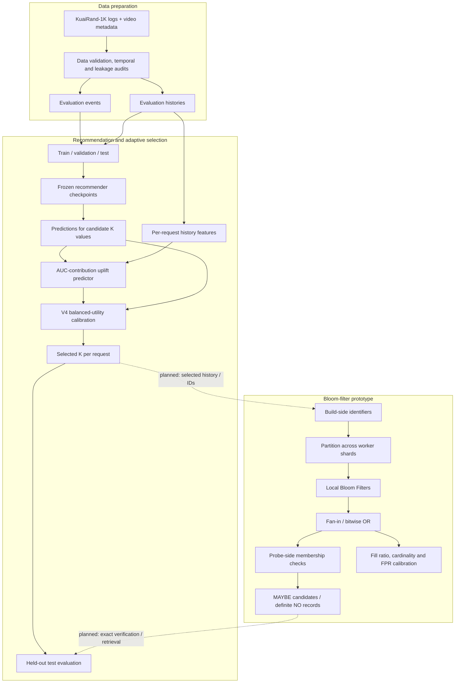
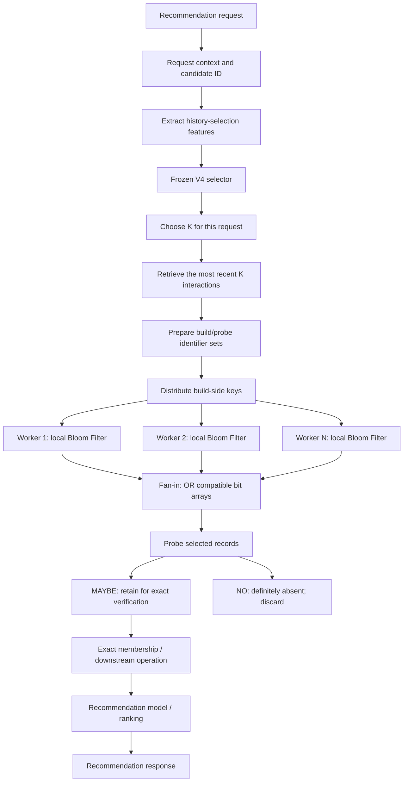
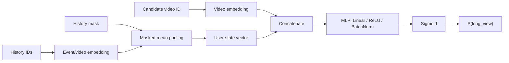
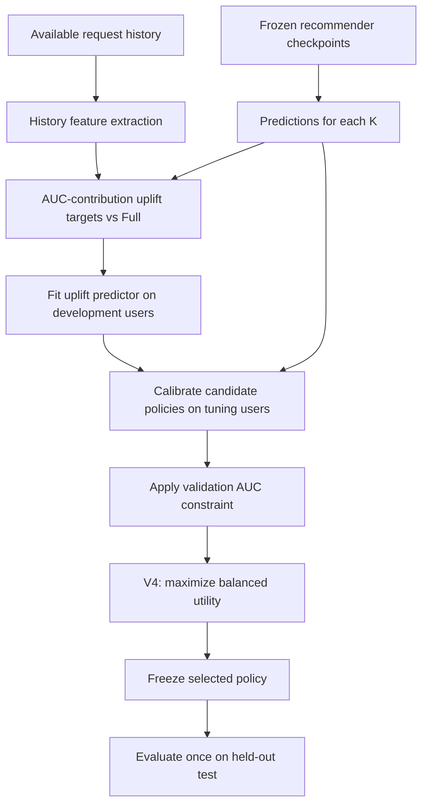
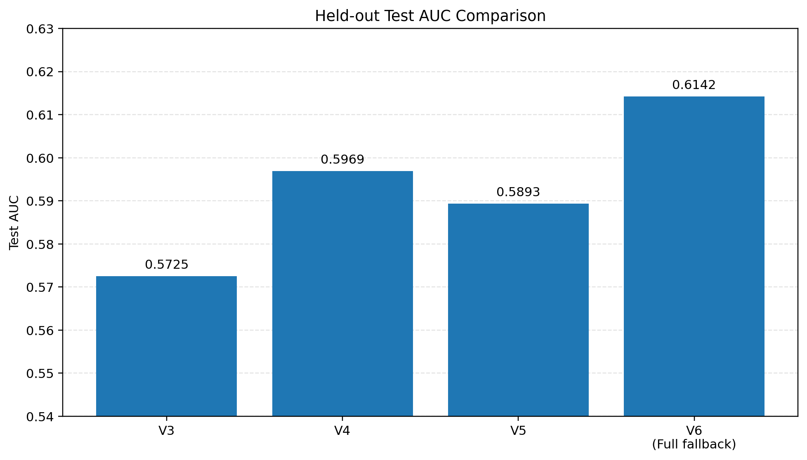
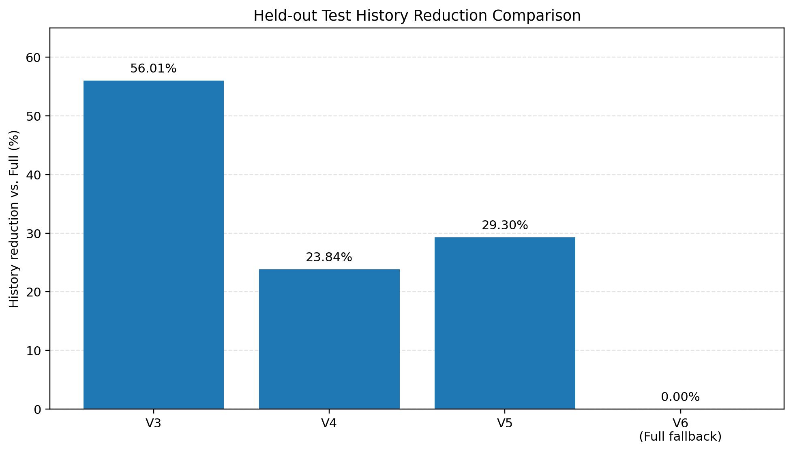
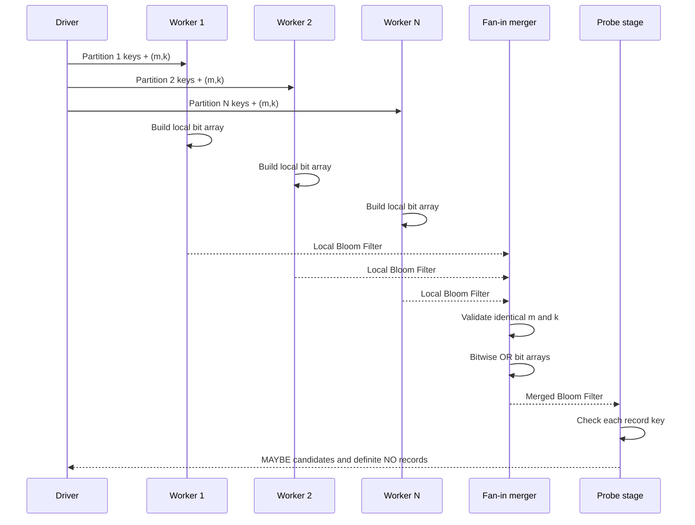

# Adaptive History Efficiency for Short-Video Recommendation

> Project 1 — adaptive behavioral-history management and a Bloom-filter pipeline prototype.

**Status snapshot: 2026-10-31**  
**Main adaptive policy: V4 (balanced quality/history utility)**

This repository studies how to reduce the amount of user behavioral history processed by a short-video recommender while controlling recommendation-quality degradation. A separate Bloom-filter prototype investigates distributed candidate filtering, fan-in/OR merging, probe-side membership checks, and parameter calibration.

## Project status

- [x] KuaiRand-1K offline data preparation, audits, and recommendation baselines
- [x] Frozen-checkpoint evaluation over multiple history lengths
- [x] Adaptive selector experiments V3, V4, V5, and V6
- [x] User-disjoint validation roles and leakage audits
- [x] Bloom Filter implementation, local multi-worker build simulation, OR merge, probe filtering, calibration
- [x] Synthetic Bloom benchmark and local KuaiRand membership/join benchmarks
- [ ] End-to-end integration of V4 decisions with the Bloom pipeline
- [ ] Real distributed execution / BLOOM-FaaS deployment
- [ ] Cloud cost, energy, and production serving-latency evaluation

The checkboxes describe the current repository status, not a claim that the complete target architecture has already been deployed.

---

## 1. Research objective

### Research question

> How can behavioral history be managed adaptively to balance recommendation quality and computational work, and how can Bloom-filter-based distributed filtering support this workflow?

Let $\pi$ be a history-selection policy, $AUC(\pi)$ its recommendation quality, $HistoryCost(\pi)$ its history-processing cost proxy, and $Full$ the policy using all available history.

$$\min_{\pi} HistoryCost(\pi) \quad \text{subject to} \quad AUC(\pi)\geq AUC(Full)-\delta.$$

The current experiments use **the number of historical interactions processed as a proxy for computational work**. This is not a direct measurement of CPU cycles, memory bandwidth, cloud billing, energy, or production latency.

Two mechanisms are studied separately:

1. **Adaptive history selection (V4):** chooses how many recent interactions should be passed to the recommender for each request.
2. **Bloom filtering:** tests whether an identifier may belong to a set, allowing definite non-matches to be discarded before an exact downstream operation.

These mechanisms are complementary but not interchangeable. Bloom rejection rate is not history-length reduction unless an integrated experiment measures that relationship explicitly.

---

## 2. System architecture

### 2.1 Current research architecture

The repository currently has two experimental tracks: the offline recommendation/adaptive-policy track and the Bloom-filter prototype. The dashed edges below are planned integration points.



**Boundary:** the current Bloom worker implementation is a local sequential simulation. It is not a deployed FaaS service, a networked distributed system, or an online recommendation-serving path.

### 2.2 Target request-time architecture

This is the intended architecture for a future integrated experiment, not a description of a deployed service.



Before implementation, define precisely: which IDs are inserted, which records are probed, whether Bloom membership is a pre-filter for retrieval or join, how the selected $K$ changes the probed records, and which exact verification follows a MAYBE result.

### 2.3 Recommender model

The baseline implementation in `src/models/baseline_models.py` contains:

1. Candidate-video embedding.
2. Historical-event/video embedding.
3. Masked mean pooling over history embeddings.
4. An MLP classifier producing $P(long\_view)$.



Conceptual tensor shapes:

| Component | Shape |
|---|---|
| Candidate IDs | `(batch_size,)` |
| History IDs and mask | `(batch_size, sequence_length)` |
| Event embeddings | `(batch_size, sequence_length, embedding_dim)` |
| Pooled user state | `(batch_size, embedding_dim)` |
| Candidate embedding | `(batch_size, embedding_dim)` |
| Full-mode concatenation | `(batch_size, 2 × embedding_dim)` |
| Prediction | `(batch_size,)` |

The model also supports `video_only` and `history_only` diagnostic modes.

### 2.4 Adaptive selector

The selector is a policy layer, not a second recommender. It uses request-level history features and a learned ranking-aligned proxy to choose among evaluated history-length actions.



The per-request AUC-contribution uplift target is a supervised proxy, not an exact additive decomposition of global AUC. The global AUC constraint is evaluated directly on the policy-tuning partition.

---

## 3. Adaptive history selector versions

Candidate actions:

```text
K ∈ {0, 1, 5, 10, 20, 50, 100, Full}
```

- $K=0$: no behavioral history.
- $K=n$: up to the most recent $n$ interactions.
- $K=Full$: all available history.

### V3 — initial learned adaptive selector

V3 replaces the earlier V2 per-request log-loss acceptance classifier with a ranking-aligned AUC-contribution uplift proxy and direct global-AUC evaluation of candidate policies.

Selected validation policy: `V3-lambda-0.066147406`.

| Metric | Validation | Test |
|---|---:|---:|
| Full AUC | 0.648593 | 0.614246 |
| Adaptive AUC | 0.622977 | 0.572519 |
| AUC difference vs Full | -0.025616 | -0.041727 |
| History cost ratio | 0.425865 | 0.439879 |
| History reduction | 57.4135% | 56.0121% |
| Mean interactions/request | 240.418 | 247.578 |
| Total interactions | — | 1,598,115 |

Test paired-bootstrap 90% CI for AUC difference vs Full: `[-0.059108, -0.026752]`.

**Interpretation:** aggressive history reduction, but comparatively large test AUC degradation.

### V4 — balanced quality/history utility (selected main policy)

V4 first applies the validation point-estimate constraint:

$$AUC(\pi)\geq AUC(Full)-\delta,\qquad \delta=0.03.$$

Normalized quality retention:

$$Q(\pi)=\mathrm{clip}\left( \frac{AUC(\pi)-[AUC(Full)-\delta]}{\delta},0,1 \right).$$

Normalized history saving:

$$S(\pi)=\mathrm{clip}\left( 1-\frac{HistoryCost(\pi)}{HistoryCost(Full)},0,1 \right).$$

Balanced geometric utility:

$$\boxed{U(\pi)=Q(\pi)^{0.6}S(\pi)^{0.4}}.$$

Among candidates satisfying the validation point-estimate constraint, V4 maximizes utility. Ties prefer higher AUC and then lower history cost. Full remains an eligible fallback.

Selected validation policy: `V4-lambda-0`.

| Metric | Validation | Test |
|---|---:|---:|
| Full AUC | 0.648593 | 0.614246 |
| Adaptive AUC | 0.631265 | 0.596878 |
| AUC difference vs Full | -0.017328 | -0.017368 |
| History cost ratio | 0.749210 | 0.761551 |
| History reduction | 25.0790% | 23.8449% |
| Mean interactions/request | 422.959 | 428.626 |
| Total interactions | — | 2,766,778 |
| Log-loss | — | 0.352331 |

Full test reference: AUC 0.614246; log-loss 0.353804; mean history interactions 562.832; total interactions 3,633,082.

Test paired-bootstrap 90% CI for V4 AUC difference vs Full: `[-0.030003, -0.004209]`.

V4 passes the **validation point-estimate** constraint. Its test CI lower bound is slightly below $-0.03$; therefore, V4 must not be described as satisfying a strict test-set LCB90 ≥ -0.03 requirement.

**Project decision:** V4 is the selected main policy because it gives the best observed quality/history balance among the learned adaptive policies considered.

### V5 — Pareto knee-point selector

V5 constructs a Pareto frontier over recommendation quality and history saving, then selects an orientation-invariant geometric knee. A fallback is used if maximum knee distance is below 0.01.

Selected validation policy: `V5-lambda-0.020309176`.

| Metric | Validation | Test |
|---|---:|---:|
| Full AUC | 0.648593 | 0.614246 |
| Adaptive AUC | 0.626405 | 0.589304 |
| AUC difference vs Full | -0.022188 | -0.024942 |
| History cost ratio | 0.701440 | 0.706970 |
| History reduction | 29.8560% | 29.3030% |
| Mean interactions/request | 395.991 | 397.906 |
| Total interactions | — | 2,568,481 |
| Log-loss | — | 0.354341 |

Validation Pareto details: 25 feasible candidates; 14 Pareto points; 3 duplicate points; status `knee_selected`; no fallback.

Test paired-bootstrap 90% CI vs Full: `[-0.038820, -0.011789]`.

**Interpretation:** V5 saves more history than V4, but gives up more AUC. They represent different trade-off points and neither strictly dominates the other on both objectives.

### V6 — LCB90-constrained Pareto knee

V6 keeps the V5 Pareto-knee strategy but strengthens feasibility. A candidate must satisfy both:

$$\Delta AUC\geq -0.03 \quad\text{and}\quad LCB_{90\%}(\Delta AUC)\geq -0.03.$$

The validation LCB is the 5th percentile of a class-stratified paired-bootstrap distribution, using 1,000 repetitions by default and seed 2026.

| Candidate | AUC | ΔAUC | LCB90 | History cost ratio |
|---|---:|---:|---:|---:|
| λ = 0 | 0.631265 | -0.017328 | -0.038920 | 0.749210 |
| λ = 0.020309176 | 0.626405 | -0.022188 | -0.045692 | 0.701440 |
| λ = 0.066147406 | 0.622977 | -0.025616 | -0.051839 | 0.425865 |

The listed learned candidates pass the point-estimate constraint but fail LCB90. Only Full remains feasible.

| Test metric | V6 result |
|---|---:|
| Selected policy | Full fallback |
| Requests selecting Full | 6,455 / 6,455 |
| Test AUC | 0.614246 |
| Test log-loss | 0.353804 |
| Mean history interactions | 562.832 |
| Total history interactions | 3,633,082 |
| History reduction | 0% |
| Test paired-bootstrap CI | [0, 0] |

V6 shows that the stricter LCB90 filter excludes the learned candidates under the current protocol. It is retained as a statistical-constraint experiment, not as the main policy.

**Statistical qualification:** the validation LCB is computed while searching a finite candidate family on the same policy-tuning partition. It is a conservative selection filter, not an independent confirmatory non-inferiority guarantee. A stronger formal claim requires an untouched confirmation set or a predeclared selection-adjusted procedure.

### Cross-version comparison (held-out test)

| Version | Test AUC | ΔAUC vs Full | History reduction | Mean interactions/request |
|---|---:|---:|---:|---:|
| V3 | 0.572519 | -0.041727 | 56.0121% | 247.578 |
| **V4** | **0.596878** | **-0.017368** | **23.8449%** | **428.626** |
| V5 | 0.589304 | -0.024942 | 29.3030% | 397.906 |
| V6 | 0.614246 | 0.000000 | 0% | 562.832 |





The V4 and V5 confidence intervals compare each policy against Full. They do not establish the significance of the direct V4-versus-V5 difference; that requires paired bootstrap resampling of both policies' predictions on the same test requests.

---

## 4. Bloom Filter fundamentals and implementation

A Bloom Filter is a space-efficient probabilistic data structure for approximate set-membership queries:

- **NO:** the item is definitely absent.
- **MAYBE:** the item may be present and should be checked exactly when correctness requires it.

A standard Bloom Filter can produce false positives but should not produce false negatives when used correctly.

### 4.1 Sizing and FPR equations

For expected inserted cardinality $n$ and target false-positive probability $\epsilon$:

$$m=-\frac{n\ln\epsilon}{(\ln 2)^2}, \qquad k=\frac{m}{n}\ln 2.$$

Approximate false-positive probability:

$$FPR\approx\left(1-e^{-kn/m}\right)^k.$$

The filter computes positions $h_i(x)\bmod m$, for $i=1,\ldots,k$. Insertion sets each corresponding bit. A query returns NO if any required bit is zero; otherwise it returns MAYBE.

### 4.2 Modules

| File | Responsibility |
|---|---|
| `src/bloom_pipeline/bloom_filter.py` | Bit array, deterministic SHA-256-based double hashing, insertion, membership, fill ratio and cardinality estimate |
| `src/bloom_pipeline/distributed_build.py` | Round-robin partitioning and one local filter per worker shard |
| `src/bloom_pipeline/merge.py` | Parameter compatibility checks and byte-wise bitwise OR |
| `src/bloom_pipeline/probe.py` | Split records into possible matches and definite non-matches |
| `src/bloom_pipeline/calibration.py` | Theoretical sizing, FPR, cardinality estimate and parameter recommendation |
| `src/bloom_pipeline/pipeline.py` | Compose local build, merge, probe and calibration |
| `src/bloom_pipeline/kuairand_experiment.py` | Membership experiment on processed KuaiRand IDs |
| `src/bloom_pipeline/benchmark.py` | Synthetic configuration benchmark |

### 4.3 Distributed build and fan-in



For compatible filters $B_j$, the merged bit array is:

$$B_{global}=B_1\lor B_2\lor\cdots\lor B_N.$$

All filters must use the same $m$, $k$, and compatible hashing/indexing rules. OR merging represents the union of keys inserted across the workers.

**Execution caveat:** the current code creates partitions and builds local filters sequentially in one Python process. It demonstrates the distributed dataflow and merge semantics, not actual parallel workers, network communication, FaaS invocation, or fault-tolerant distributed execution.

### 4.4 Calibration

Given observed fill ratio $f$, estimated cardinality is:

$$\hat n=-\frac{m}{k}\ln(1-f).$$

The calibration module uses this estimate to recommend a future bit-array size and hash count for a target FPR. It does not resize the existing filter in place.

---

## 5. Bloom experiments and measured results

### 5.1 Synthetic benchmark

The synthetic benchmark uses 10,000 build keys, 10,000 matching probes, 10,000 absent probes, and 4 simulated workers. It tests bits-per-key values 8, 10, 12, and 16 with hash counts 3, 5, and 7.

Across the recorded runs, there were zero false negatives. At 16 bits/key and 7 hashes, the recorded empirical FPR was approximately 0.06%, and about 49.97% of all probes were rejected in the balanced 50/50 workload.

These are local sequential simulation timings, not distributed speedup measurements. Full records: `reports/bloom_benchmark_runs.txt`.

### 5.2 KuaiRand membership-only benchmark

Committed result: `reports/bloom_membership_benchmark.csv`.

| Metric | Measured value |
|---|---:|
| Probe history interactions | 25,951,773 |
| Unique build-side IDs | 2,618 |
| Target FPR | 1.00% |
| Bit-array size | 25,094 bits |
| Hash functions | 7 |
| Bit array bytes | 3,137 |
| Fill ratio | 0.516020 |
| Theoretical FPR | 1.0039% |
| Empirical FPR | 0.9796% |
| Exact matches | 20,918 |
| Bloom candidates | 274,926 |
| Verified matches | 20,918 |
| False positives | 254,008 |
| False negatives | 0 |
| Rejected records | 25,676,847 |
| Rejection ratio | 98.9406% |
| Bloom build time | 0.00383 s |
| Exact lookup time | 7.06144 s |
| Bloom lookup time | 33.93355 s |
| Candidate verification time | 0.00510 s |

The recorded run shows correct membership results and a high rejection ratio on this workload. However, Bloom lookup alone took longer than exact Python set lookup. This is **not a runtime speedup**; it is evidence about membership behavior and FPR. Optimizing the probing implementation and evaluating true distributed execution remain future work.

### 5.3 KuaiRand join benchmark

Committed result: `reports/bloom_join_benchmark.csv`.

| Metric | Measured value |
|---|---:|
| Build-side unique IDs | 2,618 |
| Probe records | 25,951,773 |
| Exact matches | 20,918 |
| Target FPR | 1.00% |
| Bloom candidates | 281,621 |
| Verified matches | 20,918 |
| False positives | 260,703 |
| False negatives | 0 |
| Empirical FPR | 1.0054% |
| Records rejected | 25,670,152 |
| Rejection ratio | 98.9148% |
| Exact baseline | 1.05451 s |
| Bloom build | 0.00369 s |
| Bloom probe | 20.66912 s |
| Exact verification | 0.00593 s |
| Bloom pipeline total | 20.67873 s |
| Baseline / Bloom | 0.0510× |

The local Python Bloom pipeline is slower than the exact baseline for this benchmark. A high rejection ratio does not automatically imply lower wall-clock time: hashing and probing every record can cost more than the exact lookup being replaced.

---

## 6. Data preparation and evaluation protocol

### 6.1 Data layout

The data builder expects KuaiRand-1K raw files under:

```text
data/
├── raw/KuaiRand-1K/data/
│   ├── log_random_4_22_to_5_08_1k.csv
│   └── video_features_basic_1k.csv
└── processed/
    ├── evaluation_history.parquet
    ├── evaluation_events.parquet
    ├── train.parquet
    ├── validation.parquet
    └── test.parquet
```

Raw data is not included here. Obtain it from the authorized dataset source and place it at the paths expected by the scripts. Avoid committing raw data or private credentials.

### 6.2 Validation roles and leakage controls

The recorded user-disjoint validation audit:

| Role | Rows | Users | Positive rate |
|---|---:|---:|---:|
| Development | 3,226 | 450 | 0.0856 |
| Policy-tuning | 3,228 | 465 | 0.0861 |

Overlapping users: **0**.

Inner uplift-model fit/selection split:

| Role | Rows | Users | Positive rate |
|---|---:|---:|---:|
| Model fitting | 2,581 | 362 | 0.0856 |
| Model selection | 645 | 88 | 0.0853 |

Overlapping users: **0**.

The held-out test partition contains 6,455 requests. It is used after policy selection and must not be used to tune selector hyperparameters.

### 6.3 Metrics

- **AUC:** global ranking quality.
- **Log-loss:** probability prediction quality.
- **Mean history interactions/request:** average selected history length.
- **Total history interactions:** total selected history rows across requests.
- **History reduction:** relative reduction compared with Full.
- **Paired-bootstrap CI:** uncertainty interval for AUC difference versus Full.

$$ HistoryReduction =1-\frac{TotalInteractions_{policy}}{TotalInteractions_{Full}}. $$

---

## 7. Repository structure

Main source tree (generated data, checkpoints, and some reports omitted):

```text
shortvideo_history_efficiency/
├── README.md
├── requirements.txt
├── configs/
│   └── experiment.yaml
├── data/
│   ├── raw/                       # local KuaiRand files
│   └── processed/                 # generated datasets and artifacts
├── Documents/                     # proposal and phase reports
├── docs/                          # selector protocols and design notes
├── src/
│   ├── data/
│   │   ├── build_dataset.py
│   │   ├── build_evaluation_events.py
│   │   ├── build_history_configs.py
│   │   ├── build_split.py
│   │   └── audit_*.py
│   ├── models/
│   │   ├── baseline_models.py
│   │   └── train_baseline.py
│   ├── policy/
│   │   ├── adaptive_v3_*.py
│   │   ├── adaptive_v4_*.py
│   │   ├── adaptive_v5_*.py
│   │   ├── adaptive_v6_*.py
│   │   ├── train_adaptive_selector_v4.py
│   │   ├── train_adaptive_selector_v5.py
│   │   └── train_adaptive_selector_v6.py
│   └── bloom_pipeline/
│       ├── bloom_filter.py
│       ├── distributed_build.py
│       ├── merge.py
│       ├── probe.py
│       ├── calibration.py
│       ├── pipeline.py
│       ├── kuairand_experiment.py
│       └── benchmark.py
├── tests/
│   ├── test_adaptive_v*.py
│   └── test_bloom_*.py
├── scripts/
│   ├── data_audit.py
│   ├── benchmark_membership_only.py
│   ├── benchmark_bloom_join.py
│   └── visualize_bloom_results.py
├── models/                        # saved checkpoints / selector artifacts
└── reports/
    ├── bloom_membership_benchmark.csv
    ├── bloom_join_benchmark.csv
    ├── bloom_benchmark_runs.txt
    └── figures/
```

### Key modules

| Module | Responsibility |
|---|---|
| `src/data/` | Build evaluation datasets, temporal histories, splits, and audits |
| `src/models/baseline_models.py` | Video/event embeddings, masked mean pooling, MLP recommender |
| `src/models/train_baseline.py` | Train baseline recommendation checkpoints |
| `src/policy/adaptive_v4_features.py` | V4 request-level history features |
| `src/policy/adaptive_v4_policy.py` | Uplift targets, V4 calibration, selection and evaluation |
| `src/policy/train_adaptive_selector_v4.py` | V4 experiment entry point |
| `src/policy/adaptive_v5_policy.py` | Pareto frontier and knee selection |
| `src/policy/adaptive_v6_policy.py` | LCB90 feasibility and Pareto-knee selection |
| `src/bloom_pipeline/` | Bloom data structure and pipeline prototype |
| `tests/` | Unit tests for selector and Bloom components |
| `reports/` | Recorded benchmark outputs and figures |

---

## 8. Environment setup

The recorded development environment used Python 3.13.9 and pytest 9.1.1. The project uses PyTorch, NumPy, pandas, scikit-learn, SciPy, joblib, and pytest. Hardware selection in the recommender utilities supports CUDA, Apple MPS, or CPU when available.

```bash
python3 -m venv .venv
source .venv/bin/activate
python -m pip install --upgrade pip
pip install -r requirements.txt
```

If using another Python version, verify compatible PyTorch wheels before installing dependencies.

---

## 9. Running experiments

Run commands from the repository root.

### 9.1 Data preparation

```bash
python src/data/build_dataset.py
```

Before running, verify that the raw CSVs, evaluation-history parquet, and split parquet files exist at the paths declared in the script. Run the relevant data-audit scripts after changing data or preprocessing.

### 9.2 Train baseline recommender checkpoints

```bash
python src/models/train_baseline.py --help
```

The adaptive selector expects frozen recommendation checkpoints for the configured K values.

### 9.3 Run selected V4 policy

```bash
python src/policy/train_adaptive_selector_v4.py --help
python src/policy/train_adaptive_selector_v4.py
```

Important V4 defaults in code:

- batch size: 2,048
- random state: 42
- uplift predictor trees: 400
- minimum samples per leaf: 25
- maximum validation AUC drop: 0.03
- lambda grid: 41 steps
- quality weight: 0.6
- history-saving weight: 0.4

Expected outputs:

```text
models/adaptive_history_selector_v4.joblib
data/processed/phase9_v4/
├── adaptive_v4_metrics.csv
├── adaptive_v4_validation_policy_frontier.csv
└── adaptive_v4_test_decisions.parquet
```

### 9.4 Run comparison policies

```bash
python src/policy/train_adaptive_selector_v5.py --help
python src/policy/train_adaptive_selector_v6.py --help
```

V6 defaults to 1,000 bootstrap repetitions and seed 2026.

### 9.5 Run Bloom prototype

```bash
# Small pipeline demo
python -m src.bloom_pipeline.pipeline

# Synthetic configuration benchmark
python -m src.bloom_pipeline.benchmark

# KuaiRand membership experiment
python -m src.bloom_pipeline.kuairand_experiment

# Full membership-only benchmark
python scripts/benchmark_membership_only.py

# Bloom join benchmark
python scripts/benchmark_bloom_join.py
```

The KuaiRand Bloom scripts require:

```text
data/processed/evaluation_events.parquet
data/processed/evaluation_history.parquet
```

### 9.6 Run tests

```bash
pytest -q
```

Focused tests:

```bash
pytest -q tests/test_adaptive_v4_policy.py
pytest -q tests/test_adaptive_v5_policy.py
pytest -q tests/test_adaptive_v6_policy.py
pytest -q tests/test_bloom_filter.py
pytest -q tests/test_bloom_merge.py
pytest -q tests/test_bloom_probe.py
pytest -q tests/test_bloom_distributed.py
pytest -q tests/test_bloom_calibration.py
```

---

## 10. Outputs and reproducibility

| Artifact | Location |
|---|---|
| V4 selector model | `models/adaptive_history_selector_v4.joblib` |
| V4 metrics | `data/processed/phase9_v4/adaptive_v4_metrics.csv` |
| V4 validation frontier | `data/processed/phase9_v4/adaptive_v4_validation_policy_frontier.csv` |
| V4 test decisions | `data/processed/phase9_v4/adaptive_v4_test_decisions.parquet` |
| V6 selector model | `models/adaptive_history_selector_v6.joblib` |
| Bloom membership benchmark | `reports/bloom_membership_benchmark.csv` |
| Bloom join benchmark | `reports/bloom_join_benchmark.csv` |
| Synthetic Bloom runs | `reports/bloom_benchmark_runs.txt` |
| Bloom figures | `reports/figures/` |

For reproducibility, record the Git commit/branch, Python and package versions, dataset checksums, random seeds, checkpoint IDs, selector configuration, Bloom parameters, worker count, partitioning method, hardware, and timing methodology.

---

## 11. Limitations and interpretation rules

1. **Offline evaluation:** recommendation results use frozen checkpoints and offline request sets, not online serving.
2. **History-cost proxy:** interaction count is a processing-volume proxy, not measured infrastructure cost.
3. **V4 statistical scope:** V4 passes the validation point-estimate constraint, but its test LCB90 lower bound is -0.030003.
4. **V5 trade-off:** V5 saves more history than V4 but has a larger observed AUC drop.
5. **V6 fallback:** no learned adaptive candidate passed the LCB90 validation filter; Full was selected for all test requests.
6. **Bloom simulation:** worker partition/build/merge is local sequential simulation, not true parallel distributed execution.
7. **Bloom timing:** recorded local benchmarks do not show a speedup over exact Python set membership. A high rejection ratio alone is not proof of lower runtime.
8. **No integrated claim yet:** V4 and Bloom have not yet been evaluated as one end-to-end system.
9. **No cloud claim yet:** cloud billing, energy, serverless cold starts, autoscaling, network transfer, and production latency remain unmeasured.

---

## 12. Next milestones

### A — Freeze V4 baseline
- [x] Select V4 as main adaptive policy.
- [x] Retain V5 as higher-history-saving comparison.
- [x] Document V6 LCB90 fallback.
- [ ] Freeze reproducible V4 model/configuration/artifact bundle.
- [ ] Add direct paired-bootstrap V4-versus-V5 test comparison.

### B — Define V4/Bloom integration contract
- [ ] Specify exact identifier set inserted into Bloom filters.
- [ ] Specify records probed and semantics of MAYBE/NO.
- [ ] Define how selected K controls history retrieval and downstream records.
- [ ] Define exact verification after Bloom-positive results.
- [ ] Verify no false negatives under key normalization and merge.

### C — Move beyond local simulation
- [ ] Replace sequential simulation with actual worker processes or distributed tasks.
- [ ] Measure serialization, network transfer, fan-in, and merge overhead.
- [ ] Evaluate worker counts and skewed partitions.
- [ ] Add failure/retry and timeout behavior.
- [ ] Deploy on a cloud/serverless environment.

### D — Measure system-level trade-offs
- [ ] Measure end-to-end latency.
- [ ] Measure CPU time, memory, bytes transferred, and worker utilization.
- [ ] Measure cloud billing and energy where available.
- [ ] Compare Full, V4-only, Bloom-only, and V4 + Bloom configurations.
- [ ] Report quality, history interactions, correctness, and infrastructure cost together.

---

## 13. Project documents

- `Documents/Proposal.tex`
- `Documents/Proposal_Vie.tex`
- `Documents/Doc_phase_*.tex` and corresponding PDFs
- `docs/ADAPTIVE_SELECTOR_V3.md`
- `docs/adaptive_selector_v4_protocol.md`
- `adaptive_selector_v5_protocol.md`
- `adaptive_selector_v6_protocol.md`

The Bloom implementation is a project prototype inspired by Bloom-filter-based distributed filtering concepts. It should not be described as a complete reproduction of BLOOM-FaaS unless the original architecture and deployment have been independently implemented and verified.

---

## 14. Status summary

| Area | Status |
|---|---|
| Offline KuaiRand recommender baseline | Implemented |
| History-length candidate evaluation | Implemented |
| Adaptive selectors V3–V6 | Implemented and evaluated |
| Main policy | **V4 selected** |
| User-disjoint validation audit | Passed in recorded audit |
| Bloom Filter data structure | Implemented |
| Local multi-worker build simulation | Implemented |
| Fan-in / OR merge | Implemented |
| Probe-side filtering | Implemented |
| Bloom parameter calibration | Implemented |
| Synthetic and local KuaiRand benchmarks | Recorded |
| V4 + Bloom end-to-end integration | Planned |
| Actual distributed / FaaS deployment | Planned |
| Cloud cost and energy evaluation | Planned |

**Current contribution:** an offline adaptive-history evaluation plus a separately measured Bloom-filter pipeline prototype. The next research step is to connect these components through an explicit data contract and evaluate the integrated system.